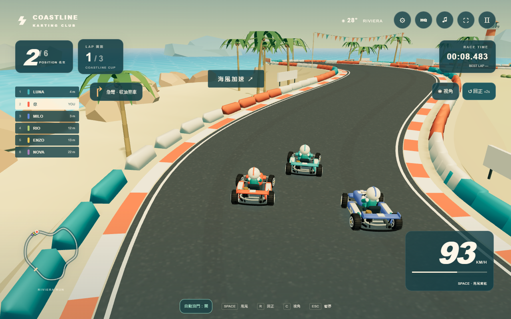

# Coastline Kart — 夕陽海岸盃

A finished, browser-native coastal kart racer. All geometry, textures, signage,
music and sound are procedurally generated locally. No Roblox Studio or Blender.

**[Play online — 夕陽海岸盃](https://jjuyp.github.io/coastline-kart/)**
No login or installation is required.

Public source: [jjuyp/coastline-kart](https://github.com/jjuyp/coastline-kart).

## Play

Double-click **Coastline-Kart.html**. The complete game is contained in this one
HTML file; no server, installation, CDN, model downloads or internet are needed.
Use a current browser with WebGL and hardware acceleration enabled.

- W / Up: throttle. S / Down: brake. A D / Left Right: steer.
- Tap a steering key for a small correction. Hold it for up to 0.95 seconds to
  progressively increase the steering angle. The maximum angle is gentler at
  high speed; release the key to center, or change direction to start a fresh turn.
  Touch steering buttons use the same timing.
- Hold Space through a turn to charge a drift. Release after the blue meter
  fills for a mini boost; charge to orange for a longer super boost.
- Turquoise road pads give a short boost.
- R: return the kart to the center of its current section (+2 seconds).
- C: change chase camera. M: mute. Esc / P: pause. Enter: start / restart.
- Open **⚙ 操作與設定** to choose gentle / standard / responsive steering,
  automatic throttle, button / analog touch steering, camera and quality.
  Preferences persist across visits. Automatic throttle defaults on for touch
  devices; switching it off exposes a manual throttle pedal.
- The analog steering pad starts neutral wherever your thumb lands. Slide left
  or right to adjust the turn proportionally; releasing centers the steering.
  Steering, braking and drifting support simultaneous fingers.
- Use **↺ 回正** when stuck (+2 seconds), or **◉ 視角** to change the chase view.
  Upcoming-turn cues, a compact HUD and a wider portrait view improve visibility.
- Opening settings or leaving the tab pauses the race and clears held input.
  Close settings, then explicitly resume. Race buttons return keyboard focus to
  the game so Space continues to drift after a mouse click.
- HQ / ECO changes rendering quality. Slow devices reduce internal rendering
  resolution automatically while retaining crisp UI.

The 682 m Riviera Run has 12 sequential gates per lap, three laps, six drivers,
wheel-to-wheel contacts, barriers, overtaking AI, individual lap times, final
standings, personal best persistence and a full pause / restart loop. AI drivers
finish after the player; the results board fills in their actual finish times.

## Source

`src/world.js` builds the circuit and coastal town. `src/kart.js` builds detailed
karts plus distant LOD variants. `src/race.js` contains fixed 120 Hz driving,
collision handling, AI pursuit and race rules. `src/main.js` integrates input,
camera, pooled VFX, UI and rendering. `src/audio.js` synthesizes original audio.
`src/steering.js` controls progressive keyboard and touch steering independently
of the AI drivers. `src/touch-controls.js` owns simultaneous pointer input and
the analog pad. `src/controls.css` styles the control sheets and responsive HUD.

For a clean checkout: `npm ci`, then `npm run build`. Run `npm run dev`
for localhost preview. The build emits `dist/index.html`, `docs/index.html` and
the standalone HTML. GitHub Pages publishes the committed `/docs` folder from
`main`; after changing the game, rebuild and commit the generated HTML before
pushing to update the playable site. `docs/.nojekyll` preserves the static build.
Development helpers can reuse the adjacent tidepool-jelly dependency installation
on this workstation; shipped HTML has no such dependency.

## Code formatting

Source files use two-space indentation, consistent line breaks and a 100-column
target. Run `npm run format` to apply the checked-in Prettier configuration, or
`npm run format:check` to verify it. Generated game bundles, dependency folders
and QA output are excluded from formatting.

## Validation

`npm run check` checks a complete three-lap simulation, ordered checkpoints,
all opponents finishing, acceleration, pause, restart, reset penalties and
reverse-driving gate rejection. Browser evidence and measured performance are
recorded under `output/playwright/`. Browser QA helpers use the existing local
Chromium installation and Playwright Core; they are workstation-specific tools.

The checked-in standalone HTML is the directly usable offline delivery. No
hosted deployment is required. Selected browser verification reports are included
under `docs/qa/`; additional workstation-only captures remain under `output/`.

Version 1.2 interaction checks are reproducible with `node scripts/ux-qa.mjs`.
Set `GAME_URL` to the hosted URL to exercise the same flows after deployment.
The suite covers preferences, focus, pause/recovery, a complete race, and touch
interaction at 320×568, 375×667, 390×844 and 844×390. Touch measurements use
Chromium emulation, not physical iOS/Android hardware.
